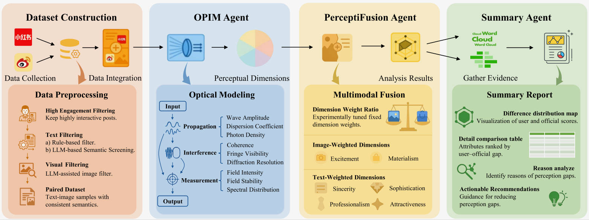

# Aligned or Apart? Multi-Agent Insights into Consumer and Brand Messaging Discrepancies

 **ACM Multimedia 2025**

*Haotian Gan, Yudong Li, WanYue Li, and Weidong Tang*



## Abstract

In the digital age, brand meaning is increasingly shaped through user participation and content sharing on social media platforms. However, significant perceptual gaps often exist between official brand narratives and consumer interpretations. These multimodal and cognitively nuanced gaps are challenging to detect and model using traditional analytical methods. To address this, we propose a multi-agent framework that metaphorically models perception as an optical process—propagation, interference, and measurement—termed **OPIM**. We construct a novel dual-perspective dataset from representative social media platforms, integrating text and image content from both user-generated and official brand communications. We evaluate brand perception along six psychological dimensions. Experiments across 15 brands demonstrate that our framework effectively captures key perception gaps, particularly in sincerity, professionalism, and attractiveness. In contrast, materialism and sophistication exhibit higher alignment between brand messaging and consumer perception. Our framework enhances the cognitive alignment and multimodal interpretability of large language models, offering actionable insights for brand strategy and bridging computational modeling with human-centric understanding.

## Repository Structure

```text
opim/                     OPIM package (import as `opim`)
  agents/                 text, image, summary, evaluation, and fusion agents
  models/                 memory and reflection models for text and images, shared memory hub
  opim_metrics.py         measurement-stage equations (Eqs. 1-3)
  api_config.py           model endpoint configuration
data/
  xiaohongshu/text/       user-generated notes, one JSONL file per brand
  xiaohongshu/images/     user-generated images, one folder per brand
  weibo/text/             official brand posts, one JSONL file per brand
  weibo/images/           official brand images, one folder per brand
requirements.txt
```

### Data Format

Xiaohongshu note (`data/xiaohongshu/text/<Brand>.jsonl`):

```json
{
  "record_id": "Stable record identifier",
  "brand": "Chanel",
  "source": "xiaohongshu_user",
  "title": "Note title",
  "content": "Note text",
  "keywords": ["tag", "tag"],
  "publish_date_date": "YYYYMMDD",
  "like_cnt": 123,
  "collection_cnt": 45,
  "comment_cnt": 6,
  "repost_cnt": 1,
  "interaction_cnt": 175
}
```

Weibo post (`data/weibo/text/<Brand>.jsonl`):

```json
{
  "record_id": "Stable record identifier",
  "brand": "Chanel",
  "source": "weibo_official",
  "text": "Post text as exported",
  "content": "Normalized post text",
  "created_at": "Sun Feb 20 11:00:34 +0800 2022",
  "attitudes_count": 41,
  "comments_count": 6,
  "reposts_count": 2
}
```

## 🚀 Quick Start

### Prerequisites

```bash
pip install -r requirements.txt     # pinned versions target Python 3.8
export PYTHONPATH="$PWD"
export OPIM_API_KEY=<your key>
```

The agents call an OpenAI-compatible `chat/completions` endpoint. The defaults are Google's Gemini endpoint (`https://generativelanguage.googleapis.com/v1beta/openai/chat/completions`) and the model `gemini-2.0-flash`; override them with `OPIM_API_ENDPOINT` and `OPIM_API_MODEL`.

### Basic Usage

```python
import json
from opim.agents.text_analysis_agent import TextAnalysisAgent
from opim.agents.image_analysis_agent import ImageAnalysisAgent

with open("data/xiaohongshu/text/Chanel.jsonl", encoding="utf-8") as f:
    records = [json.loads(line) for line in f]

text_agent = TextAnalysisAgent(project_root="runs/chanel")
text_results = text_agent.analyze(records, output_folder="runs/chanel")
print(text_results["dimension_scores"])

image_agent = ImageAnalysisAgent(project_root="runs/chanel")
image_report = image_agent.process_folder("data/xiaohongshu/images/Chanel", output_dir="runs/chanel")
```

## Citation

```bibtex
@inproceedings{gan2025aligned,
  title={Aligned or Apart? Multi-Agent Insights into Consumer and Brand Messaging Discrepancies},
  author={Gan, Haotian and Li, Yudong and Li, Wanyue and Tang, Weidong},
  booktitle={Proceedings of the 33rd ACM International Conference on Multimedia},
  pages={6558--6566},
  year={2025}
}
```
